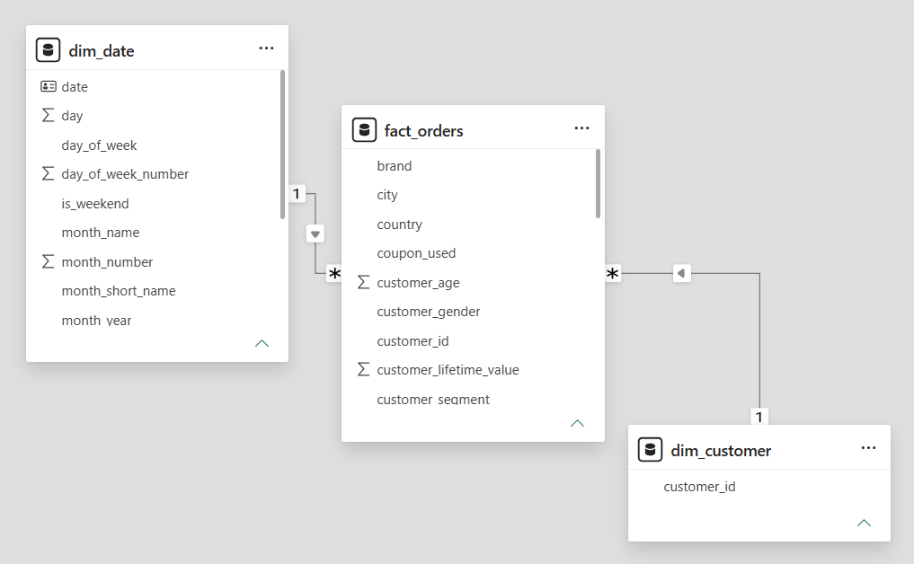
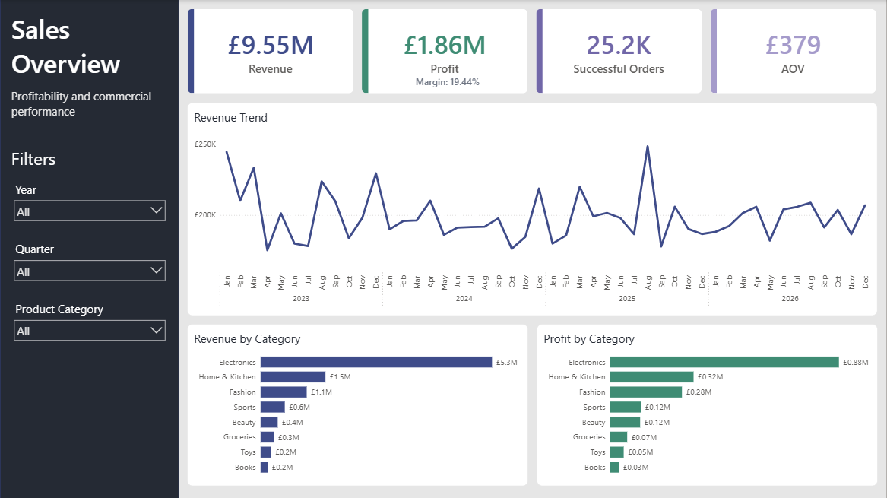
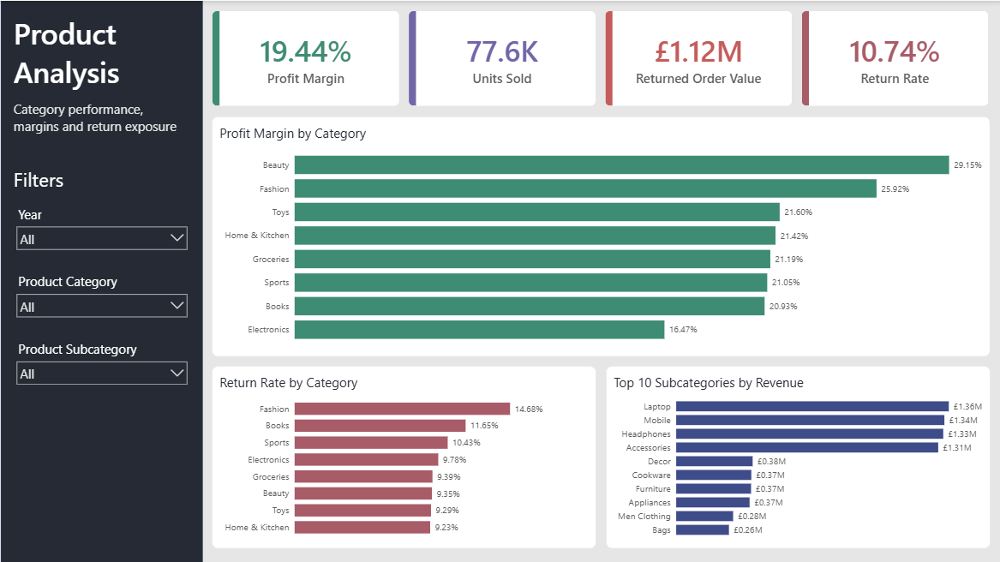
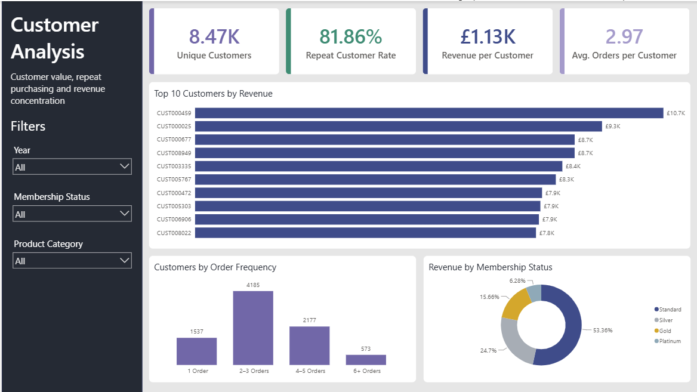
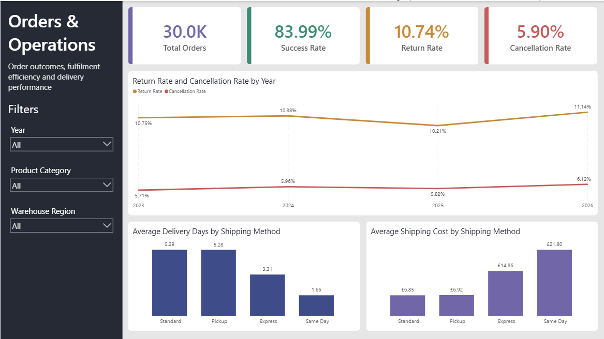

# Ecommerce Orders Analysis

## Navigation

[Overview](#project-overview) •
[Data Model](#data-model) •
[Dashboard](#dashboard) •
[Recommendations](#recommendations) •
[Technical Implementation](#technical-implementation) •
[Conclusion](#conclusion)

## Project Overview

This project uses **PostgreSQL**, **SQL** and **Power BI** to analyse 30,000 ecommerce orders between 2023 and 2026, with the aim of evaluating overall business performance, identifying the main drivers of revenue and profitability, understanding customer purchasing behaviour, and assessing operational performance.

The project demonstrates:

- Data cleaning and validation using **SQL**
- Exploratory and business-focused analysis using **PostgreSQL**
- Data modelling and relationship validation
- **DAX** measure development
- KPI design and business-rule implementation
- Interactive dashboard development in **Power BI**

The analysis aims to answer business questions such as:

- How are revenue, profit and order volumes performing over time?
- Which product categories generate the most revenue and profit?
- Which product areas provide the strongest margins?
- Where is return exposure highest?
- How important are repeat customers to the business?
- How concentrated is customer revenue?
- How frequently do customers place successful orders?
- How stable are cancellation and return rates?
- What are the operational trade-offs between shipping speed and shipping cost?

## Data Model

A star-schema-inspired model was developed around the `fact_orders` table, supported by dedicated **Date** and **Customer** dimensions.

The Date dimension provides a continuous calendar for time-based filtering and DAX time intelligence, while the Customer dimension contains the unique customer identifier required for customer-level analysis.

Cancelled and returned orders remain in the dataset for operational analysis, while realised revenue, profit and units are calculated using successful orders only.

Dataset source:  
[kaggle](https://www.kaggle.com/datasets/mmumairkhattak/e-commerce-orders-dataset-2026-scra)

## Dashboard

### 1. Sales Overview

#### Key Findings

- The business generated approximately **£9.55M in realised revenue** and **£1.86M in realised profit**, representing an overall profit margin of approximately **19.44%**.

- Performance remained relatively stable between 2023 and 2026. Revenue declined by **5.55% in 2024**, recovered by **2.13% in 2025**, and remained broadly flat in 2026.

- **Electronics** is the dominant commercial category, generating approximately **55.82% of realised revenue** and **47.29% of realised profit**.

- Revenue concentration in Electronics is accompanied by a comparatively low **16.47% profit margin**, indicating that the category contributes substantial sales volume but converts a smaller proportion of revenue into profit than other categories.

- Monthly revenue shows moderate variation rather than strong seasonality, with August producing the highest average monthly revenue and November the lowest across the analysed period.

### 2. Product Analysis

#### Key Findings

- **Beauty** achieves the highest category profit margin at **29.15%**, followed by Fashion at **25.92%**, while Electronics records the lowest margin at **16.47%**.

- Electronics generates approximately **£5.33M in realised revenue**, substantially more than any other category, demonstrating the business's significant reliance on Electronics for overall sales performance.

- **Fashion has the highest return rate at 14.68%**, considerably above the overall return rate of **10.74%**. Bags record the highest return rate within Fashion at approximately **16.51%**.

- Electronics presents a different form of return exposure. Although its return rate is lower than Fashion's, returned Electronics orders account for approximately **£587K in associated order value**, representing more than half of the value associated with all returned orders.

- Electronics subcategories dominate the leading revenue positions, with Laptop, Mobile, Headphones and Accessories each generating more than **£1.3M** in realised revenue.

### 3. Customer Analysis

#### Key Findings

- **8,472 customers** placed at least one successful order during the analysed period.

- Repeat purchasing is common, with **81.86% of successful customers** placing two or more successful orders.

- Customers place an average of approximately **2.97 successful orders**, while realised revenue averages approximately **£1.13K per successful customer**.

- The largest purchase-frequency group consists of customers placing **2–3 successful orders**, representing 4,185 customers. A further 2,177 customers placed 4–5 orders, while 573 customers placed six or more.

- Customer revenue is concentrated among higher-value customers. The top 10% of customers by realised revenue contribute approximately **33.86% of customer revenue**, while the top 20% contribute approximately **53.40%**.

- Orders recorded under **Standard membership status** generate the largest share of realised revenue at approximately **53.47%**, followed by Silver at **24.70%**, Gold at **15.71%** and Platinum at **6.12%**.

### 4. Orders & Operations

#### Key Findings

- Of **30,000 total orders**, approximately **83.99%** were successfully completed without cancellation or return.

- The overall **cancellation rate is 5.90%**, while the return rate among non-cancelled orders is **10.74%**, making returns the more significant operational outcome within the dataset.

- Cancellation and return rates remain relatively stable across the four-year period. Return rates range from approximately **10.21% to 11.14%**, while cancellation rates remain between approximately **5.71% and 6.12%**.

- Shipping speed is strongly differentiated by method. **Same Day** orders average approximately **1.66 delivery days**, compared with **3.31 days for Express** and approximately **5.3 days for both Pickup and Standard**.

- Faster shipping is associated with substantially higher shipping costs. Same Day shipping averages approximately **£21.80**, compared with **£14.86 for Express**, **£6.92 for Pickup** and **£6.85 for Standard**.

- Pickup and Standard provide very similar average delivery times and shipping costs, while Express and Same Day represent progressively faster but more expensive fulfilment options.

## Recommendations

- **Investigate Electronics profitability while protecting its revenue contribution.** Electronics generates more than half of realised revenue but records the lowest category profit margin. Further analysis of product costs, pricing and supplier economics could identify opportunities to improve profitability without undermining the category's substantial sales contribution.

- **Prioritise investigation into Fashion returns.** Fashion records the highest category return rate at **14.68%**, with Bags showing particularly high return frequency. Return-reason data would help determine whether sizing, product expectations, quality or other factors contribute to this pattern.

- **Monitor the financial exposure associated with Electronics returns.** Electronics does not have the highest return frequency, but its high average order value means returned orders represent a substantial proportion of total returned order value.

- **Support repeat purchasing and customer retention.** More than **80% of successful customers** place multiple orders, and repeat purchasers account for the overwhelming majority of realised revenue. Retention initiatives should therefore remain an important part of the commercial strategy.

- **Continue monitoring returns as the primary operational issue.** Cancellation rates remain relatively low and stable, while returns occur more frequently. Product-level return analysis therefore offers a stronger improvement opportunity than broad cancellation reduction initiatives.

## Technical Implementation

Key technical elements of the project included:

- Using **PostgreSQL** for data cleaning, validation, exploratory analysis and business-focused SQL analysis.

- Developing separate SQL analysis scripts for exploratory analysis, sales performance, product profitability, customer behaviour and operational performance.

- Defining consistent business logic to distinguish **total orders, cancelled orders, returned orders and successful orders**.

- Calculating **realised revenue, realised profit and units sold using successful orders only**, preventing cancelled and returned transactions from overstating commercial performance.

- Creating reusable **DAX measures** for realised revenue, realised profit, successful orders, average order value, profit margin, cancellation rate, return rate and customer behaviour.

- Developing dynamic customer measures for **unique customers, repeat customer rate, average orders per customer and revenue per customer**.

- Designing synchronized visual styling and slicers across four Power BI report pages covering Sales, Products, Customers and Operations.

## Conclusion

The analysis shows that the ecommerce business maintains relatively stable commercial performance across the analysed period, generating approximately **£9.55M in realised revenue** from more than **25,000 successful orders**.

Electronics is the primary driver of revenue but operates at the lowest category margin, creating an important profitability consideration. Product return behaviour also varies meaningfully: Fashion experiences the highest return frequency, while Electronics carries the greatest value exposure associated with returned orders.

Customer analysis highlights the importance of repeat purchasing, with the majority of customers placing multiple successful orders and higher-frequency customers contributing substantially to overall revenue. Operationally, cancellation and return rates remain relatively stable, while shipping analysis demonstrates a clear trade-off between delivery speed and cost.

Overall, the findings suggest that future performance improvements are more likely to come from **improving product-level profitability, reducing targeted return exposure, strengthening repeat purchasing and optimising fulfilment economics** than from broad changes to overall order volume.
